# WAKOrd

Tune, learn chords, train your ear, and share chord progressions.

WAKOrd is an Android music companion for guitarists, ukulele players, and every musician who wants to tune, learn, and create in one place.

| Home | Explore | Song | Tuner | Analyze | Profile |
|---|---|---|---|---|---|
| 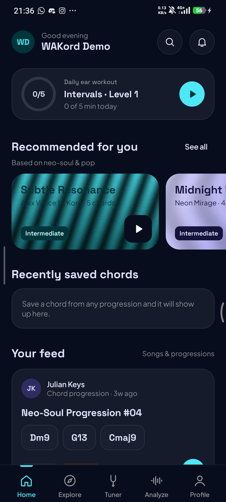 | 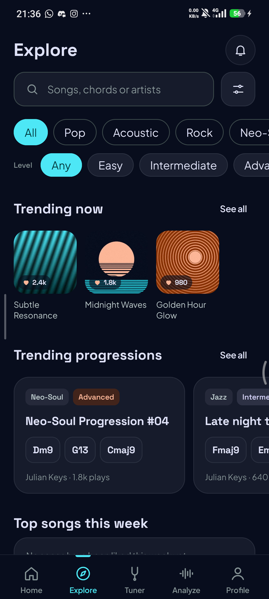 | 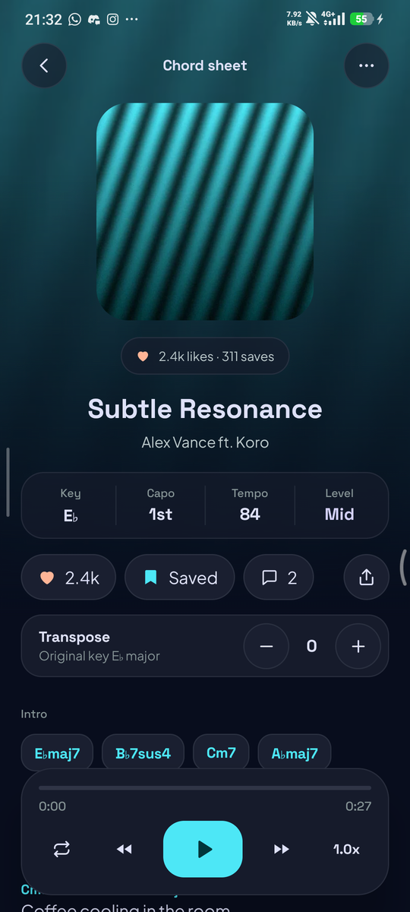 | 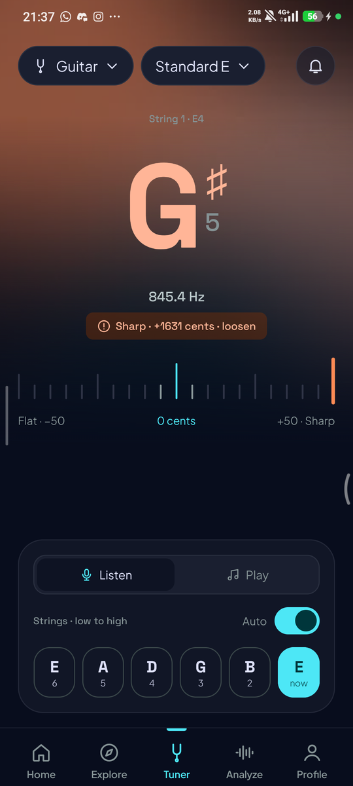 | 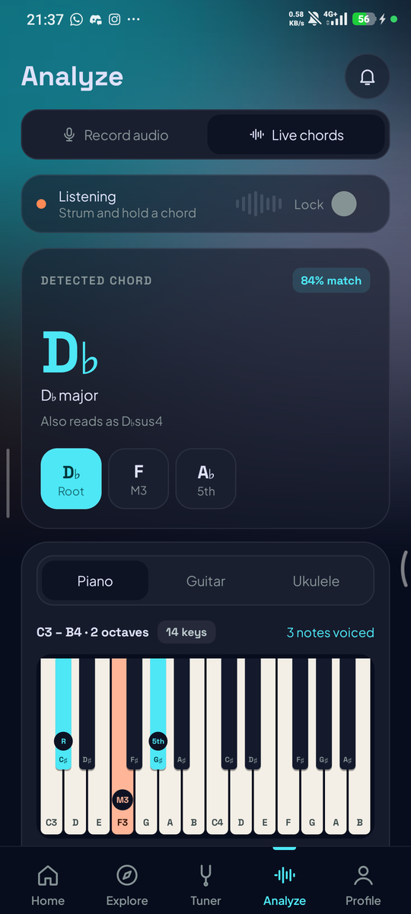 | 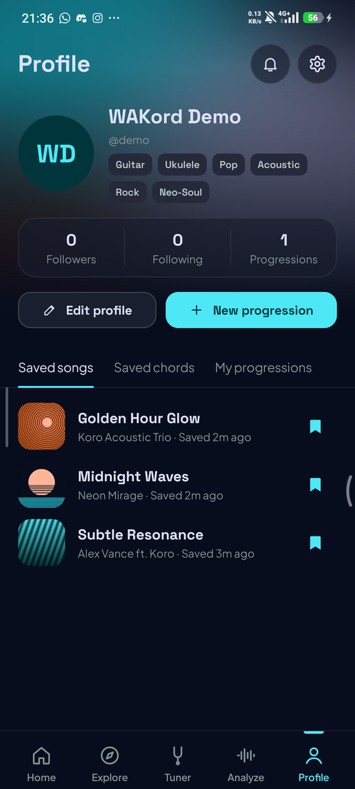 |
| 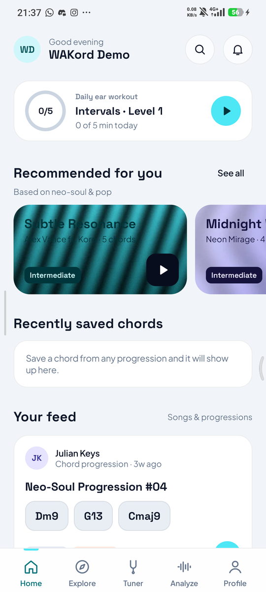 | 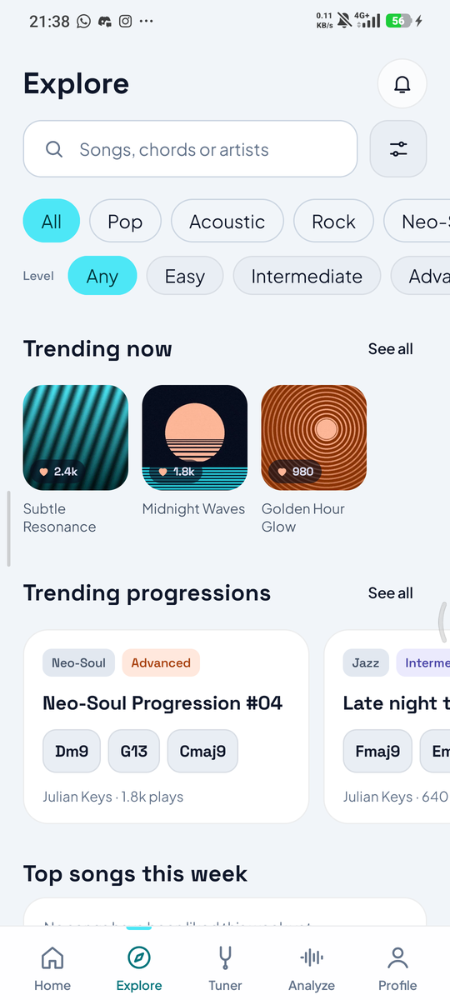 | 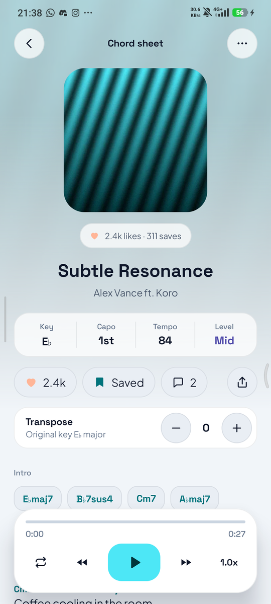 | 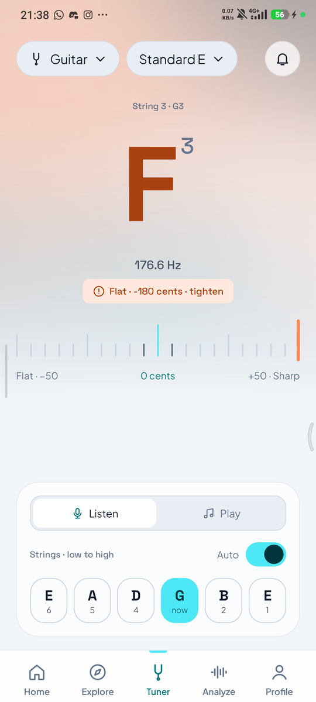 | 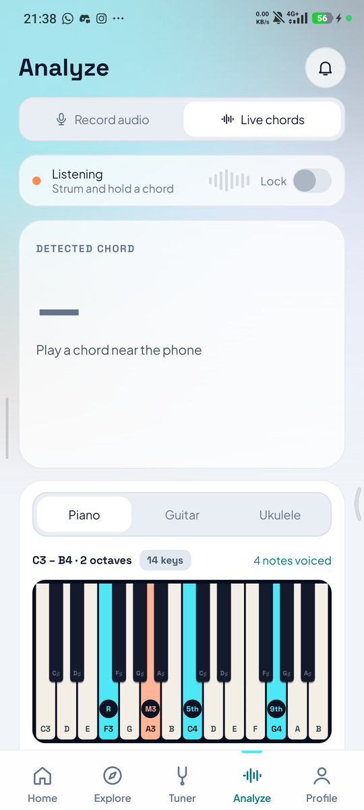 | 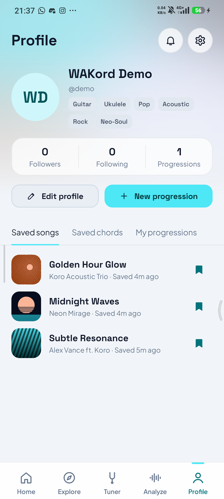 |

## Features

- **Tuner**: real-time tuner for guitar, ukulele, bass, mandolin and violin, alternate and custom tunings, and a pitch pipe.
- **Analyze**: record up to 30 seconds to detect chords and key with Gemini, or read chords live while you strum. Voicings for piano, guitar and ukulele, and a chord track you can save as a progression. An on-device algorithm takes over when the AI is unavailable.
- **Ear & pitch training**: a daily workout with streaks, a pitch monitor, and levels from single notes to chord progressions.
- **Songs & chord sheets**: lyrics with chords, one-tap transpose, playback with speed control, likes, saves and comments.
- **Discover**: a personal feed from your instruments and genres, trending songs and progressions, search, and genre and level filters.
- **Create & share**: write and upload chord progressions, follow other musicians, and get notified about likes, comments, replies and follows.
- Saved songs and chords work offline, dark and light themes, English and Indonesian.

## Tech stack

- Kotlin, Jetpack Compose with Material 3
- MVVM with a manual dependency container
- Firebase Authentication, Realtime Database and Firebase AI Logic (Gemini)
- Room for offline saved items
- Min SDK 26, target SDK 37

## Build and run

1. Clone the repository and open it in Android Studio.
2. Let Gradle sync. The Firebase config in app/google-services.json is already included.
3. Run the app configuration on a device or emulator with Android 8.0 or newer.

From the command line:

```
./gradlew installDebug
./gradlew testDebugUnitTest lintDebug
```

The database schema and security rules are described in [docs/database.md](docs/database.md). Sample data lives in seed/wakord-seed.json.

## Demo account

| Email | Password |
|---|---|
| demo@wakord.app | WakordDemo26 |

The demo account already has saved songs, preferences and one uploaded progression. You can also register a new account from the app.

## Team

- KO
- WA
